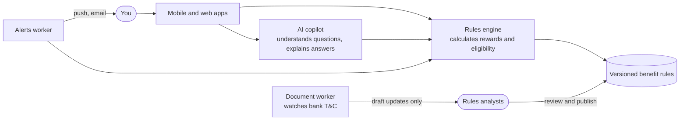

# CardGuru

**Know what your cards can do for you, and use the right one every time.**

CardGuru is a mobile and web app for credit and debit card holders in India. You tell it which cards you have, and it tells you:

- **which card to use before you pay**, with the maths shown
- **which benefits you already have** (lounge access, milestones, fee waivers, insurance, forex markup), with an "Avail now" action on each
- **when to act**, with alerts for quota resets, points expiry, milestone and fee-waiver deadlines, renewals, and devaluations when a bank cuts a benefit
- **what to use on a trip**, including the best card abroad and the lounges at your airports
- **whether a different card would suit you better** (upgrade advisor) and **what your cards earned you this year** (annual review)
- **how to claim a benefit**, with step-by-step claims guides

Every benefit shows a "Verified on" date and a link to the bank's terms.

You can also just ask a question in plain English, like *"Which card should I use for a 12,000 rupee flight booking?"*, and get an answer with the reasoning and a link to the bank's terms.

---

## Project status

> **Stage: design.** There is no application code yet.

| Item | Status |
|---|---|
| Phase 0: plan | Done, see [`docs/ARCHITECTURE.md`](docs/ARCHITECTURE.md) and [`CLAUDE.md`](CLAUDE.md) |
| Phase 1: monorepo foundation | Not started |

Progress is tracked in [`docs/PROGRESS.md`](docs/PROGRESS.md). Each phase is built from a prompt in [`BUILD_PROMPTS.md`](BUILD_PROMPTS.md).

---

## How it works



Three ideas shape the design:

- **The rules engine is the only thing that calculates numbers.** The AI copilot reads your question and explains the result, but it never works out rewards or fees on its own. If no verified rule exists, it says so instead of guessing.
- **Benefit rules are versioned and reviewed by people.** When a bank changes its terms, the document worker proposes a draft, and an analyst and a reviewer check it before anything is published. Nothing is auto-published.
- **Privacy and security first.** CardGuru never asks for or stores your full card number, CVV or expiry date. You sign in with a passkey (your fingerprint or face). The app follows India's Digital Personal Data Protection (DPDP) Act, and you choose what you consent to, purpose by purpose.

---

## Planned tech stack

These are proposals in the architecture doc and may change once the open questions are answered.

| Layer | Choice |
|---|---|
| Mobile | Expo with Expo Router (iOS and Android) |
| Web and admin | Next.js |
| API | NestJS on the Fastify adapter, TypeScript |
| Database | PostgreSQL 16 with Drizzle ORM |
| Jobs and alerts | Redis with BullMQ |
| Document worker | Python 3.12 |
| Login | Passkeys (WebAuthn), phone check at sign-up and recovery only |
| AI | Provider-agnostic, with Claude and Gemini adapters |
| Monorepo | pnpm workspaces and Turborepo |
| Testing | Vitest, fast-check, Testcontainers, Maestro, Playwright, pytest, k6 |
| CI | GitHub Actions |
| Hosting | AWS Mumbai (`ap-south-1`), set up with Terraform |

---

## Planned repository layout

```
apps/
  mobile/         Expo app (iOS and Android)
  web/            Consumer web app
  admin/          Console for rules analysts
  api/            HTTP API, including the AI copilot
workers/
  alerts/         Scheduled and event alerts, delivery
  docs/           Python: watches bank T&C and proposes draft rules
packages/
  rules-engine/   Reward and eligibility calculations (no I/O)
  shared/         Schemas and the typed API client
  ui/             Design tokens
  db/             Database schema, migrations, demo seed data
evals/            Test questions for the AI copilot
infra/            Terraform
docs/             Architecture, progress, runbooks, compliance
```

Only `docs/` exists today. Seed data uses fictional "Demo Bank" cards only.

---

## Roadmap

| Phase | What gets built |
|---|---|
| 0. Plan | Architecture, open questions, `CLAUDE.md` |
| 1. Monorepo foundation | Folder structure, tooling, local Postgres and Redis, CI |
| 2. Rules engine and data model | Calculation engine and database schema, with demo cards |
| 3. API | Passkey login, device security, all endpoints, typed client |
| 4. Mobile app | iOS and Android app with wallet, "ask before you pay", trips, alerts |
| 5. Web app | The same flows on the web, accessible down to phone width |
| 6. Admin console | Rule editing, review queue, publishing, impact preview |
| 7. Alerts worker | Deadline, renewal and devaluation alerts by push and email |
| 8. AI copilot | Ask questions in plain English, with a 100-question test set in CI |
| 9. Document worker | Watches bank T&C and drafts rule updates for review |
| 10. Production hardening | Cloud setup, monitoring, security review, load tests, runbooks |

Each phase has exit criteria in [`docs/ARCHITECTURE.md`](docs/ARCHITECTURE.md#7-phased-delivery-plan-matches-build_promptsmd).

---

## Getting started

There is nothing to install or run yet. Local setup steps will be added here in Phase 1, when the monorepo scaffold lands.

---

## Contributing

- Work on a feature branch and open a pull request into `main`.
- Build one phase at a time from [`BUILD_PROMPTS.md`](BUILD_PROMPTS.md), and keep each pull request focused on one phase or one change.
- Never commit secrets, real card numbers or real personal data, including in test fixtures.

---

## Disclaimer

CardGuru gives information about card benefits based on public bank terms. It is not financial advice. Banks can change their terms at any time, so always check the latest terms with your card issuer.

---

## License

[MIT](LICENSE) © 2026 Sandipan Banerjee
