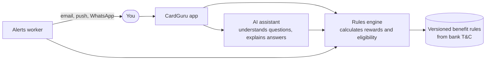

# CardGuru

**Know what your credit cards can do for you, and use the right one every time.**

CardGuru is an app for credit card holders in India. You tell it which cards you have, and it tells you:

- which card earns the most on a given spend (dining, travel, fuel, online shopping and so on)
- which benefits you already have (lounge access, milestones, fee waivers, insurance, forex markup)
- when to act, with alerts for annual fees, milestones, lounge quota resets and changes the bank makes to your card's terms
- what to use on a trip, including the best card abroad and which airport lounges you can get into

You can also just ask a question in plain English, like *"Which card should I use for a 12,000 rupee flight booking?"*, and get an answer with the reasoning and a link to the bank's terms.

---

## Project status

> **Stage: design.** There is no application code yet.

| Item | Status |
|---|---|
| Architecture draft | Done, see [`docs/ARCHITECTURE.md`](docs/ARCHITECTURE.md) |
| Open questions on the architecture | Waiting for answers (section 8 of the architecture doc) |
| Phase 1 (identity and consent) | Not started |

---

## How it works



Three ideas shape the design:

- **The rules engine is the only thing that calculates numbers.** The AI assistant reads your question and explains the result, but it never works out rewards or fees on its own. If an answer contains a number the engine didn't produce, CardGuru shows a plain template answer instead.
- **Benefit rules are versioned.** When a bank changes its terms, we add a new version with the date it takes effect, and we never edit the old one. Every answer can be traced to the exact rule version and the bank document it came from.
- **Privacy first.** CardGuru never asks for or stores your full card number, CVV or expiry date. It follows India's Digital Personal Data Protection (DPDP) Act. You choose what you consent to, purpose by purpose, and you can withdraw consent at any time.

---

## Planned tech stack

These are proposals in the architecture doc and may change once the open questions are answered.

| Layer | Choice |
|---|---|
| Language | TypeScript (Node 22 LTS) |
| API | NestJS on the Fastify adapter |
| Database | PostgreSQL 16 with Drizzle ORM |
| Queues and jobs | Redis with BullMQ |
| Web apps | Next.js (consumer app and internal admin console) |
| AI | LLM provider behind an interface, Claude by default |
| Monorepo | pnpm workspaces and Turborepo |
| Testing | Vitest, fast-check, Testcontainers, Playwright |
| CI | GitHub Actions |
| Hosting | AWS Mumbai (`ap-south-1`) |

---

## Planned repository layout

```
apps/
  api/            HTTP API
  worker/         Background jobs and alerts
  web/            Consumer web app
  admin/          Internal console for authoring benefit rules
packages/
  db/             Database schema, migrations, seed data
  rules-engine/   Reward and eligibility calculations (no I/O)
  rule-schemas/   Validation schemas for each kind of benefit rule
  ai/             Prompts, tools, redaction and answer checks
  contracts/      Shared API types
  config/         Shared lint and TypeScript config
evals/            Test sets for the AI assistant
docs/             Architecture, decision records, runbooks
```

Only `docs/` exists today.

---

## Roadmap

| Phase | What gets built |
|---|---|
| 0. Foundations | Architecture sign-off, coding conventions, monorepo scaffold, CI |
| 1. Identity and consent | Phone OTP login, privacy notice, per-purpose consent, audit log |
| 2. Card catalog and rules | Card products, versioned benefit rules, admin console with two-person approval |
| 3. Rules engine and wallet | Add your cards, get "best card for this spend" with an explanation |
| 4. AI assistant | Ask questions in plain English, with answer checks and quality tests |
| 5. Alerts | Fee, milestone, lounge and rule change alerts across your chosen channels |
| 6. Trips | Best card abroad, forex costs, lounge access for your airports |
| 7. Data rights and hardening | Download or delete your data, security testing, load testing |
| 8. Beta launch | Staged rollout and feedback |

Each phase has exit criteria in [`docs/ARCHITECTURE.md`](docs/ARCHITECTURE.md#7-phased-delivery-plan).

---

## Getting started

There is nothing to install or run yet. Setup steps will be added here in Phase 0, when the monorepo scaffold lands.

---

## Contributing

- Work on a feature branch and open a pull request into `main`.
- Keep pull requests focused on one phase or one change.
- Never commit secrets, real card numbers or real personal data, including in test fixtures.

---

## Disclaimer

CardGuru gives information about card benefits based on public bank terms. It is not financial advice. Banks can change their terms at any time, so always check the latest terms with your card issuer.

---

## License

[MIT](LICENSE) © 2026 Sandipan Banerjee
