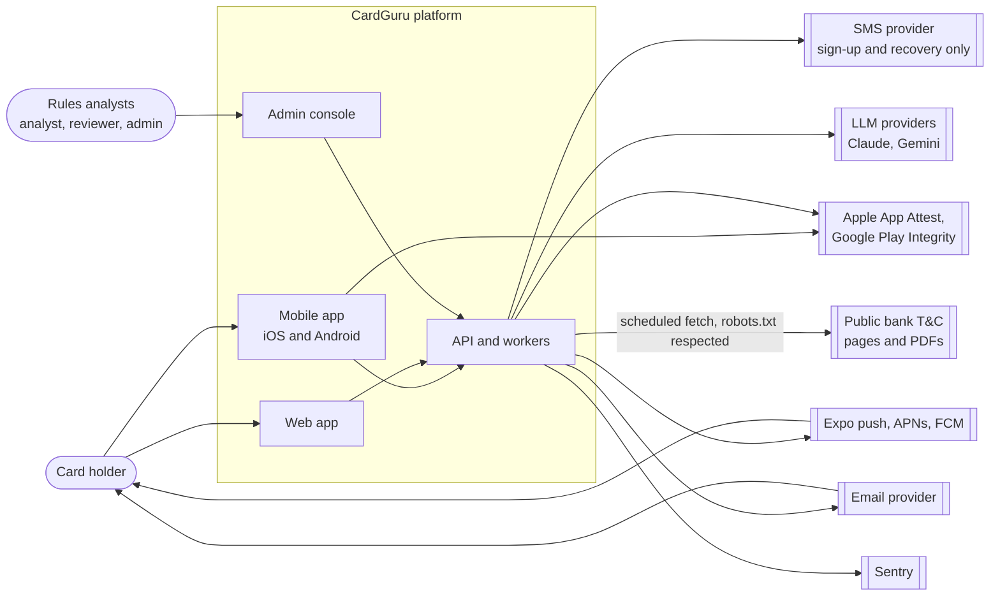
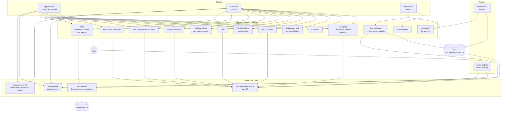
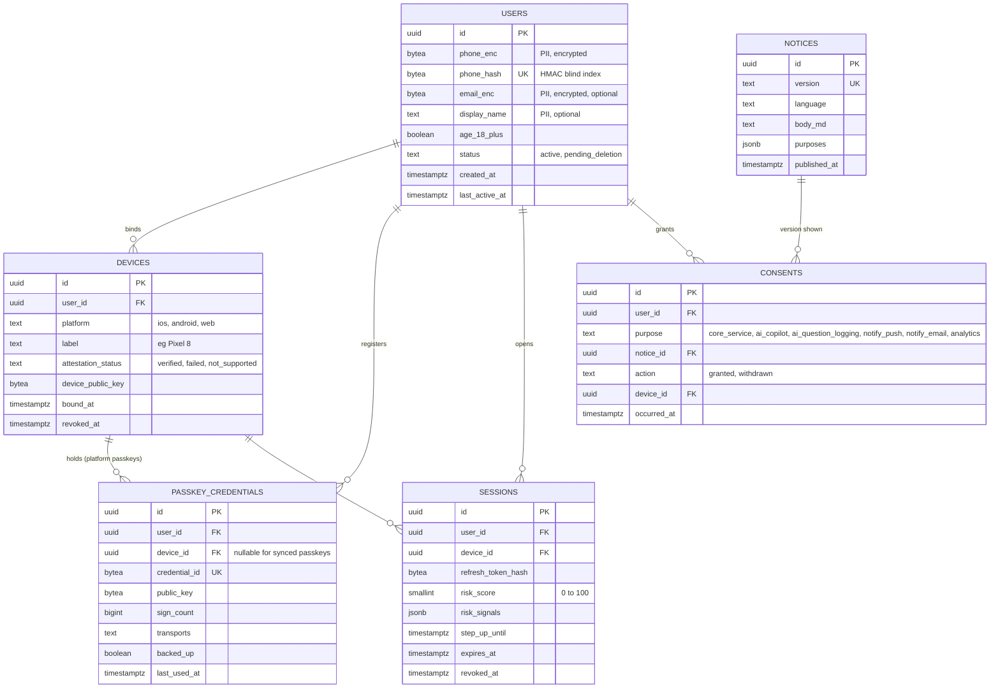
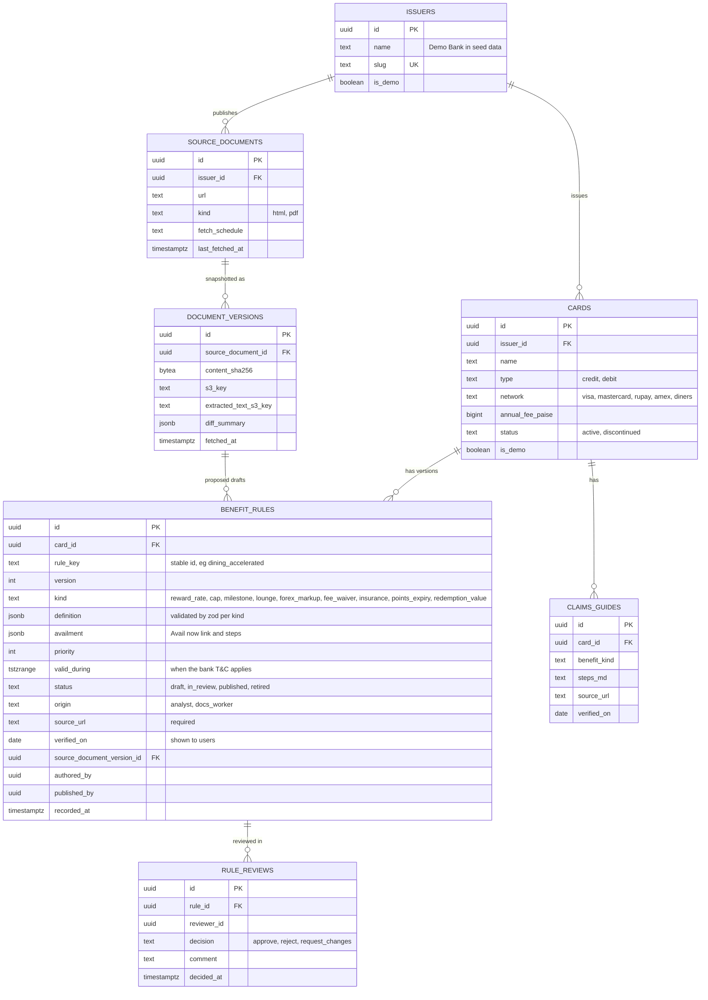
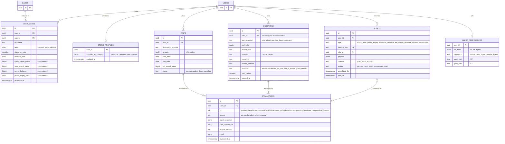
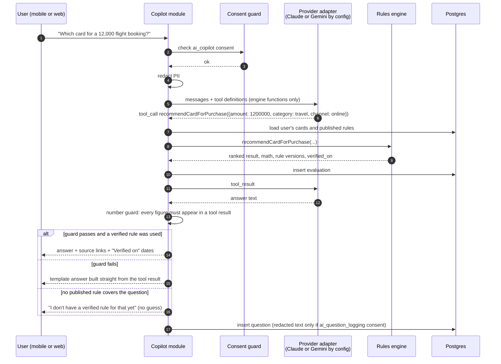
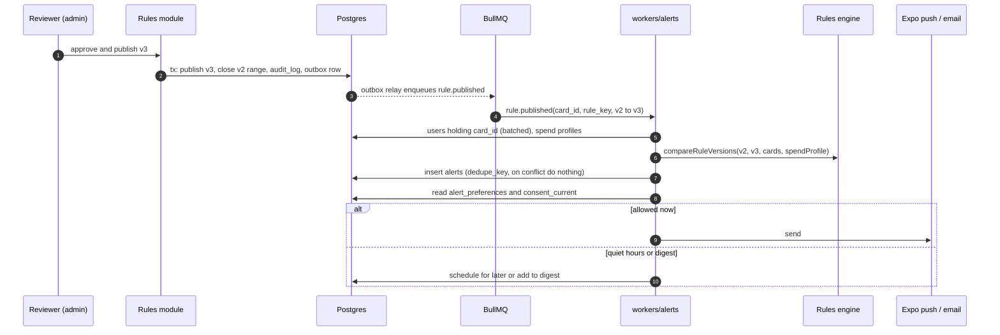
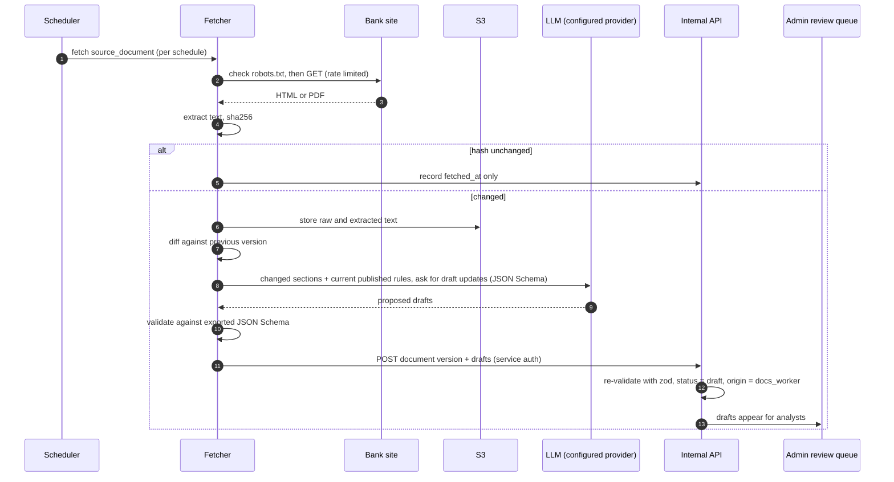
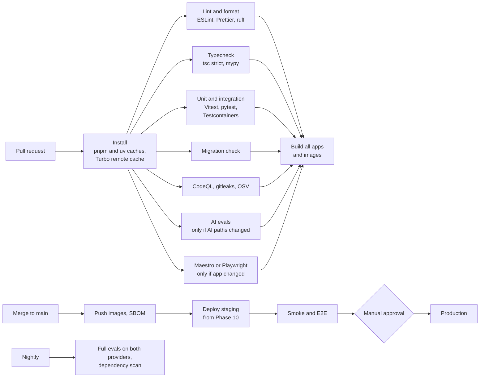

# CardGuru Architecture

| Field | Value |
|---|---|
| Status | v0.3, open questions answered. Ready to merge and start Phase 1. |
| Date | 2026-10-14 |
| Scope | Architecture only. No application code exists yet. |
| Inputs | [`BUILD_PROMPTS.md`](../BUILD_PROMPTS.md) (phases 0 to 10) and [`CLAUDE.md`](../CLAUDE.md) (non-negotiable rules and conventions). |
| Change history | v0.3: section 8 answered, `CLAUDE.md` added. v0.2: rewritten to match `BUILD_PROMPTS.md`: mobile first, passkeys, Claude and Gemini adapters, Python document worker, 11 phases. |

---

## 0. Inputs and assumptions

### 0.1 Confirmed by BUILD_PROMPTS.md

| # | Fact | Phase |
|---|---|---|
| C1 | Clients: Expo mobile app (iOS and Android) first, Next.js web app mirroring it, Next.js admin console for rules analysts | 1, 4, 5, 6 |
| C2 | Login is by passkey (WebAuthn). Phone verification is used only at sign-up and as one step of recovery, through a pluggable SMS provider (mocked in dev). | 3 |
| C3 | Device binding, session risk scoring and step-up authentication for sensitive actions | 3 |
| C4 | The rules engine is pure TypeScript, deterministic, with no I/O, and exposes 5 named functions | 2 |
| C5 | Benefit rules are versioned with the status flow draft, in_review, published, retired | 2 |
| C6 | Seed data contains **only fictional demo cards**. No real bank benefits are invented. | 2 |
| C7 | The AI layer is provider-agnostic, with Claude and Gemini adapters. The model can only call rules-engine functions and never states numbers that didn't come from a tool. | 8 |
| C8 | A Python worker monitors bank T&C pages and proposes draft rules. **Drafts are never auto-published.** | 9 |
| C9 | Alerts go out by push and email. WhatsApp is stubbed for later. | 7 |
| C10 | Every benefit shows "Verified on <date>" and a source link | 4, 8 |
| C11 | Production runs in an India cloud region, set up with Terraform | 10 |

### 0.2 Still assumed (please confirm)

| # | Assumption | Affects |
|---|---|---|
| A1 | Users are people in India with credit and debit cards ("Demo Bank Debit Classic" suggests debit cards are in scope too). | All |
| A2 | We **never** store full card numbers (PAN), CVV or expiry. A user's card is a link to a card product, plus an optional nickname and the last 4 digits. | 3, 5 |
| A3 | Confirmed (Q3): we don't read transactions from banks, SMS or email. Spend, points balances and milestone progress come from **user-entered estimates**. | 3, 4 |
| A4 | Cloud is AWS Mumbai (`ap-south-1`). | 1, 5 |
| A5 | Users are 18 or older, so the DPDP children's data rules are handled by an age gate. | 5 |
| A6 | Small team (1 to 3 engineers) plus AI-assisted development. | 2 |

---

## 1. System context and components

### 1.1 System context



### 1.2 Containers and components



**Key decisions shown above**

- **The rules engine is one pure library** used by the API, the AI copilot, the admin impact preview and the alerts worker. Every surface gives the same number for the same input.
- **`packages/db` is an addition** to the layout in `BUILD_PROMPTS.md`. Phase 2 builds the schema before the API exists in Phase 3, and both the API and `workers/alerts` need it. Putting it in `packages/shared` would pull database code into the mobile bundle. See Q13.
- **The Python document worker talks to the API, not straight to Postgres.** Rule validation (zod) and audit logging then stay in one place. Python checks its LLM output against JSON Schemas exported from the zod schemas, and the API validates again with zod.
- **The admin console has its own login** (SSO with MFA) and role checks, separate from consumer passkeys.

### 1.3 Repository layout

```
apps/
  mobile/         Expo + Expo Router (iOS, Android)
  web/            Next.js consumer web app
  admin/          Next.js admin console for rules analysts
  api/            NestJS (Fastify adapter), includes the AI copilot module
workers/
  alerts/         Node + BullMQ: scheduled and event jobs, delivery
  docs/           Python: T&C fetch, extract, diff, draft proposals
packages/
  rules-engine/   Pure TS evaluation library
  shared/         zod schemas, rule kind schemas, generated typed API client
  ui/             Design tokens (colours, type, spacing, light and dark)
  db/             Drizzle schema, migrations, demo seed (proposed addition)
evals/            Golden AI question set and runner
infra/            Terraform (Phase 10)
docs/             ARCHITECTURE, PROGRESS, RUNBOOK, COMPLIANCE, ADRs
docker-compose.yml  Postgres and Redis for local development
```

Tooling: pnpm workspaces, Turborepo, Node 22 LTS, TypeScript strict. Python 3.12 with `uv`, `ruff` and `mypy` for `workers/docs`.

---

## 2. Framework and ORM choices

### 2.1 API framework: NestJS vs Fastify

| Criterion | NestJS | Fastify (plain) |
|---|---|---|
| Structure for 13+ endpoint groups across many phases | Modules, DI, guards and interceptors are built in | You design and enforce the structure yourself |
| Passkeys, device binding, risk scoring, step-up | Guards compose cleanly, for example `@StepUp('export')` and `@RequiresConsent('ai_logging')` | Hooks. Works, but you build the pattern |
| Audit logging, rate limiting | Interceptors and `@nestjs/throttler`, one central place | Hooks and plugins |
| OpenAPI spec and typed client | `@nestjs/swagger` with `nestjs-zod` generates the spec from the same zod schemas | `@fastify/swagger` with a zod type provider. Also good |
| Raw performance | Close to Fastify when run on the Fastify adapter | Best |
| Testability | DI makes swapping the LLM adapter, clock, SMS provider and DB easy | Manual |
| AI-assisted development | Strong conventions keep generated code consistent across phases | More drift between phases |
| Downsides | Decorators, boilerplate, steeper first week | Conventions have to be written down and policed |

**Recommendation: NestJS running on the Fastify adapter.**

- Phase 3 is the heaviest phase: passkeys, device binding, risk scoring, step-up, rate limiting, audit logging and 13 endpoint groups. These are cross-cutting concerns, and Nest's guards and interceptors are designed for exactly that.
- The Fastify adapter keeps us comfortably inside the Phase 10 target of p95 under 300 ms. The engine is pure CPU work in memory, so framework overhead is a small share of that time.
- Validation is zod everywhere (via `nestjs-zod`), so the schemas in `packages/shared` drive the API, the OpenAPI spec, the typed client and the admin forms.
- Passkeys use `@simplewebauthn/server`.

**What would change my mind:** nothing in the prompts points to plain Fastify. It would only win if the API became a thin layer, and it doesn't.

### 2.2 ORM: Prisma vs Drizzle

| Criterion | Prisma | Drizzle |
|---|---|---|
| Schema style | Own DSL | TypeScript, close to SQL |
| Postgres features we need: JSONB, exclusion constraint on version ranges, partial unique indexes | Some need hand-written SQL beside the schema | Expressed in the schema, or in plain SQL migrations Drizzle manages |
| Migrations | Generated, less transparent | Plain SQL files, easy to review in PRs |
| Complex queries (rules in effect on a date, impact preview across users) | Often falls back to raw SQL | Typed query builder handles them |
| Runtime weight in API and worker | Heavier (lighter since v7) | Thin |
| Ecosystem | Larger | Smaller but active |

**Recommendation: Drizzle with PostgreSQL 16.**

- Versioned rules depend on a Postgres **exclusion constraint** (two published versions of the same rule can't overlap in time) and on JSONB rule definitions. Drizzle handles both without a second migration system.
- SQL-first migrations are easier to review for a schema with personal and financial data.
- JSONB columns are typed with the same zod schemas from `packages/shared`.

---

## 3. Data model

### 3.1 Conventions

- Primary keys are `uuid` v7.
- Money is `bigint` **paise**, rates are `numeric(10,6)`, and points are `bigint`. Floats are never used for money.
- Timestamps are `timestamptz` in UTC, shown in IST.
- PII columns are marked `-- PII` and listed in `docs/COMPLIANCE.md` (Phase 10).
- Sensitive PII (phone, email) uses envelope encryption with KMS. Lookups use an HMAC "blind index" column such as `phone_hash`.
- Personal data is never soft-deleted. Account deletion is a hard delete or irreversible anonymisation (section 5.3).

### 3.2 Identity, devices and consent



### 3.3 Catalog, rules and document monitoring



### 3.4 User activity



Also needed: `audit_log` (append-only), `admin_users` with roles `analyst`, `reviewer`, `admin`, `data_rights_requests`, `notification_deliveries` (one row per provider attempt) and `outbox` (section 4.5).

### 3.5 Table notes

**users, devices, passkey_credentials, sessions**

- Phone is stored encrypted and used only at sign-up and recovery. Login is by passkey.
- A device is "bound" when it registers a passkey and, on mobile, passes attestation (App Attest or Play Integrity).
- `sessions.risk_score` is recalculated on each refresh from signals such as a new device, unusual location, failed attestation or high request rate. A high score forces step-up.
- `step_up_until` is set by a fresh passkey check and lasts 5 minutes. Sensitive actions need it: data export, account deletion, adding or removing a device, and changing phone or email.

**consents** (append-only event log)

- Each grant or withdrawal is a new row. A view called `consent_current` gives the latest state per purpose.
- `ai_question_logging` is separate from `ai_copilot`. A user can use the copilot without their questions being stored, which is what "log questions (with consent)" in Phase 8 means.

**cards and issuers**

- Product catalog. `is_demo` marks the fictional seed data, and the apps show a "Demo" badge on these cards.

**benefit_rules** (versioned)

- A published row is never updated. A change is a new `version` with its own `valid_during` range.
- Two published versions of the same rule can't overlap in time:

```sql
ALTER TABLE benefit_rules ADD CONSTRAINT no_overlapping_published
  EXCLUDE USING gist (card_id WITH =, rule_key WITH =, valid_during WITH &&)
  WHERE (status = 'published');
```

- `source_url` is required (Phase 6), and `verified_on` is shown to users (Phases 4 and 8).
- `availment` holds the "Avail now" target: a deep link or URL plus short steps.
- Drafts from the document worker have `origin = docs_worker` and can only enter `draft` status.
- Moving to `published` needs a `reviewer` approval in `rule_reviews` from someone other than the author.
- Here's an example of the `reward_rate` kind (fictional card):

```json
{
  "scope": { "categories": ["dining"], "channels": ["online", "offline"] },
  "earn": { "points": 5, "per_amount_paise": 15000 },
  "stacking": "replaces_base",
  "exclusions": ["fuel", "rent", "wallet_load", "emi"],
  "cap_ref": "dining_monthly_cap"
}
```

**user_cards and spend_profiles**

- No PAN, CVV or expiry. `last4` is optional and for display only.
- The spend, points and expiry fields are **user estimates**. Without them, `getUpcomingDeadlines` (milestones, points expiry) and the upgrade advisor have nothing to work from. See Q3.

**evaluations**

- One immutable row per engine call, holding the inputs, exact rule versions, engine version and result. That's enough to reproduce and explain any number shown to a user.

**alerts**

- `dedupe_key` (for example `renewal:{user_card_id}:2026`) makes jobs idempotent, as Phase 7 requires.

---

## 4. How the rules engine, AI layer and workers interact

### 4.1 The core principle

> The rules engine is the only source of numbers. The AI copilot understands the question and explains the answer. It never calculates rewards, fees or eligibility, and it refuses when no verified rule exists.

### 4.2 Rules engine (`packages/rules-engine`)

**Shared input:** the user's cards, the **published** rules in effect on the context date, and a context (amount, merchant category, channel, date, airport, trip). The date is always passed in, never read from the clock.

| Function | Answers | Used by |
|---|---|---|
| `getWalletBenefits(cards, rules, ctx)` | All benefits per card, with availment, `verified_on` and source | Wallet screen, copilot |
| `recommendCardForPurchase(cards, rules, purchase)` | Cards ranked by value, with step-by-step maths, caps and exclusions | "Ask before you pay", copilot |
| `getTripBenefits(cards, rules, trip)` | Forex cost, lounge access at the trip's airports, travel insurance | Trip mode, alerts |
| `getUpcomingDeadlines(cards, rules, userState, date, horizon)` | Quota resets, points expiry, milestone and fee-waiver deadlines, renewals | Alerts worker, wallet |
| `compareRuleVersions(oldRules, newRules, cards, spendProfile)` | Yearly value change per user (devaluation impact) | Admin impact preview, devaluation alerts |

**A 6th function (decided, Q14).** The upgrade advisor and annual review need "yearly value of card X for this spend profile", so the engine adds `estimateAnnualValue(card, rules, spendProfile)`. It's built on the same logic as `recommendCardForPurchase`, so the maths isn't duplicated.

**Output contract.** Every result includes:

- the value in paise and points
- a `math` array of readable steps, for example `12,000 / 150 x 5 = 400 pts`, then `400 x 0.50 = 200`
- the caps applied and the exclusions hit
- the IDs of the rule versions used, plus their `verified_on` dates and source URLs

**How rules are applied:** filter by scope, then resolve conflicts by `priority`, then specificity, then stacking mode. Next apply caps, convert points to rupees using `redemption_value` rules, and finally rank.

### 4.3 AI copilot



**Design rules**

- **Provider-agnostic.** A `LlmProvider` interface with `ClaudeAdapter` and `GeminiAdapter`, chosen by config (`AI_PROVIDER=claude|gemini`). Both adapters map the same tool definitions to each provider's format. Evals run against whichever provider is configured.
- **Tools are only engine functions.** The `user_id` comes from the session and is never taken from the model's arguments. No tool can write data.
- **Number guard.** Every currency figure, percentage or point value in the answer must appear in a tool result in the same turn. If not, a deterministic template answer is shown instead.
- **No verified rule, no answer.** If the needed rule doesn't exist or isn't published, the copilot says so and offers to flag the gap to the analysts.
- **Redaction** of phone numbers, emails, 12 to 19 digit card-like numbers and names (where possible) happens before every provider call.
- **Prompt and model versions** are stored with each question, so eval results can be traced.

### 4.4 Alerts worker (`workers/alerts`)

A Node service using BullMQ on Redis. It imports `packages/db` and `packages/rules-engine` directly. It doesn't need NestJS.

| Job | Trigger | Engine call | Alert types |
|---|---|---|---|
| Daily deadlines scan | Repeatable, 07:00 IST, batched by user | `getUpcomingDeadlines` | `quota_reset`, `points_expiry`, `milestone_deadline`, `fee_waiver_deadline`, `renewal` |
| Trip prep | Trip start minus 3 days | `getTripBenefits` | `trip_prep` |
| Rule published | Outbox event from the API | `compareRuleVersions` per affected user | `devaluation` (or `improvement`) |
| Delivery | After an alert is created | none | push via Expo, email. WhatsApp is an interface with a no-op implementation |



**Reliability**

- A **transactional outbox** means a rule is never published without its event, or the reverse.
- **Retries** use exponential backoff for 5 attempts, then a **dead-letter queue** with a Sentry alert.
- **Consent and preferences are checked at send time**, so a withdrawal takes effect straight away.
- **Push payloads carry no personal details**, for example "You have an update about one of your cards". The app fetches the details after login, because push goes through Expo, Apple and Google servers.

### 4.5 Document worker (`workers/docs`, Python)



**Rules for the document worker**

- **It can never publish.** The internal API token for `workers/docs` only has permission to create drafts. Publishing is checked by role on the server, not left to the worker's own code.
- **Bank documents are untrusted input.** Text from bank pages could contain instructions aimed at the LLM (prompt injection). That's acceptable here because the worst outcome is a bad draft that a reviewer rejects.
- **Stack:** `httpx`, `urllib.robotparser`, `trafilatura` for HTML, `pdfplumber` for PDFs, `difflib` for diffs, and a minimal provider adapter using the same `AI_PROVIDER` config.

---

## 5. Security and DPDP compliance

### 5.1 Regulatory frame

| Source | What it means for us |
|---|---|
| Digital Personal Data Protection Act, 2023 | We are a Data Fiduciary. We need consent with a clear notice, purpose limitation, data minimisation, security safeguards, breach notification and data principal rights. |
| DPDP Rules, 2025 (notified November 2025, phased start) | These add detail on notice content, consent managers, breach reporting timelines, keeping logs for at least 1 year, and erasure notices. Most obligations start about 18 months after notification. **Counsel must confirm the dates and what applies to us.** |
| RBI card data rules (tokenisation, card-on-file) | We store no PAN, CVV or expiry, and at most the last 4 digits. |
| IT Act and CERT-In directions | Report incidents within 6 hours. Keep logs for 180 days in India. |
| TRAI DLT rules for commercial SMS | OTP SMS in India needs a registered sender ID and templates with the SMS provider. |

> This is an engineering approach, not legal advice. Counsel should review it before public launch.

### 5.2 DPDP controls

| Requirement | How CardGuru meets it |
|---|---|
| Notice before consent | Versioned `notices` per language, shown during onboarding. Each consent row records the notice version. |
| Specific, informed consent | Separate toggles per purpose. Nothing pre-ticked. Only `core_service` is required. |
| Withdrawal as easy as giving | One tap per purpose in Settings, then Consents. Guards and the alerts worker read `consent_current` live. |
| Purpose limitation | `@RequiresConsent(purpose)` on routes for optional purposes. CI fails if a route lacks a purpose annotation. |
| Minimisation | No PAN, no transactions, spend as user estimates, questions stored redacted and only with consent, push payloads free of personal details. |
| Right to access | Data export (needs step-up). A JSON and PDF bundle is built by a worker job, with a 24-hour signed link. |
| Right to erasure | Account deletion (needs step-up). Hard delete or anonymisation within a stated SLA. A pseudonymous record is kept in `audit_log`. |
| Correction | Users can edit their profile, cards, spend profile and trips. |
| Retention | A retention table per data class, enforced by a nightly purge job (periods in Q11). |
| Grievance and nominee | In-app grievance form and nominee setting. `data_rights_requests` tracks the SLA. |
| Breach | Runbook in `docs/RUNBOOK.md`: notify the Data Protection Board and affected users without delay, the detailed report within 72 hours, and CERT-In within 6 hours. |
| Processors | Data processing agreements with Anthropic, Google, the SMS provider, the email provider, Expo, Sentry and AWS. Zero retention on LLM APIs where offered. Sentry scrubs PII. |
| Cross-border | Personal data is stored in India. LLM providers receive only redacted text (Q10). |
| Checklist | `docs/COMPLIANCE.md` in Phase 10. |

### 5.3 Security controls

| Area | Control |
|---|---|
| Consumer auth | Passkeys (WebAuthn) as the only everyday login. Phone OTP only at sign-up and as one recovery factor, rate-limited per phone, IP and device. Recovery needs a phone OTP **plus** a second factor (email link or a cooling-off period), so SIM swap alone isn't enough. |
| Sessions | 15-minute access token and a rotating refresh token bound to the device key. Refresh token reuse revokes the whole session family. |
| Risk and step-up | A risk score per refresh. Step-up with a fresh passkey check for sensitive actions, valid for 5 minutes. |
| Mobile hardening | Certificate pinning, App Attest and Play Integrity attestation checked on the server, root and jailbreak detection (warn, and block sensitive actions), and `FLAG_SECURE` or iOS screenshot masking on sensitive screens. All of these need an Expo **development build**, not Expo Go. |
| Mobile storage | Tokens in the iOS Keychain or Android Keystore (`expo-secure-store`). Offline wallet cache in encrypted storage, cleared on logout. |
| Web | httpOnly, SameSite=strict cookies, strict CSP, HSTS. WCAG 2.1 AA also covers secure, accessible auth flows. |
| Admin | SSO with MFA, roles `analyst`, `reviewer` and `admin`, four-eyes publishing, every action in `audit_log`. |
| Data | RDS and S3 encrypted with KMS, envelope encryption for PII columns, and separate keys per environment. |
| Secrets | AWS Secrets Manager. Only `.env.example` files are committed. gitleaks runs in CI. |
| AI | Read-only tools scoped to the session user, number guard, redaction, and document worker output limited to drafts. |
| Supply chain | Renovate, lockfiles (pnpm, uv), CodeQL, OSV scan, SBOM per image. |
| Assurance | OWASP ASVS Level 2 review and fixes in Phase 10, a STRIDE threat model in Phase 3, and an external pen test before public launch. |

---

## 6. Testing strategy and CI pipeline

### 6.1 Test layers

| Layer | Tool | Scope | Gate |
|---|---|---|---|
| Engine unit tests | Vitest, table-driven | All 5 (or 6) engine functions | **95% or more** line and branch coverage (Phase 2) |
| Engine properties | fast-check | Rewards never exceed caps, excluded spend earns 0, ranking doesn't depend on input order, money stays a whole number of paise | Runs with unit tests |
| API integration | Vitest + Testcontainers (Postgres, Redis) | **Every endpoint** (Phase 3): happy path, validation errors, auth, step-up, consent denied, rate limit | Required |
| Contract | OpenAPI spec diff, typed client compile | Breaking API changes are caught before mobile and web break | Required |
| Mobile E2E | Maestro | Onboarding and wallet flows (Phase 4) | Required on mobile changes |
| Web E2E | Playwright + axe | Onboarding, wallet, trip mode (Phase 5), plus WCAG checks | Required on web changes |
| Workers | Vitest (alerts), pytest (docs) | Idempotency, retries, quiet hours, robots.txt, diff, draft-only permission | Required |
| AI evals | `evals/` runner | 100 golden questions (Phase 8): right tool and arguments, no figures outside the tool results, refuses when no rule exists, sources present | **Fails below the configured accuracy threshold** |
| Load | k6 | Wallet and recommendation endpoints | p95 under 300 ms (Phase 10) |

**How AI evals run in CI.** They make real LLM calls, which cost money, can give slightly different results each run, and need an API key in CI. My proposal:

- Run them on PRs that touch `apps/api/src/ai`, `evals/` or `packages/rules-engine`, on `main`, and nightly.
- Keep provider keys only in a protected GitHub environment, so PRs from forks can't run them.
- Since you'll have both, run them against each provider nightly.

### 6.2 CI pipeline (GitHub Actions)



- Phase 1 delivers the core of this pipeline: install, lint, typecheck, test and build. Each later phase adds its own jobs.
- Turbo only runs what a PR changed. The target is under 10 minutes.
- Migrations are expand-then-contract, so a rollback never breaks the schema.

---

## 7. Phased delivery plan (matches BUILD_PROMPTS.md)

| Phase | Name | Main deliverables | Exit criteria |
|---|---|---|---|
| 0 | Plan | This document, answers to section 8, `CLAUDE.md` | Done in PR #1 once merged |
| 1 | Monorepo foundation | pnpm and Turbo, `apps/*`, `workers/*`, `packages/*` (plus `packages/db`), Docker Compose, lint, format and TS strict, CI, `.env.example`, README setup, `docs/PROGRESS.md` | One command starts every app, and each shows a health check. CI green. |
| 2 | Rules engine and data model | `packages/rules-engine` (5 functions), Drizzle schema for section 3, rule status flow, demo seed only | Engine coverage at 95% or more, table-driven tests, exclusion constraint tested, no real bank data in the seed |
| 3 | API | Passkeys, phone verification with a mock SMS provider, device binding, risk scoring, step-up, all endpoint groups, zod, rate limits, audit log, OpenAPI, typed client in `packages/shared` | Integration test for every endpoint. Threat model written. |
| 4 | Mobile app | All listed screens, security hardening, design tokens, light and dark, "Verified on" plus source, Expo push, offline wallet, Maestro, EAS config | Maestro onboarding and wallet flows pass on iOS and Android dev builds |
| 5 | Web app | Same flows as mobile, responsive to 360 px, WCAG 2.1 AA | Playwright onboarding, wallet and trip mode tests pass. No serious axe violations. |
| 6 | Admin console | Roles, rule editor with required `source_url`, version diff, review queue, publish with audit, impact preview using `compareRuleVersions` | An analyst drafts, a reviewer approves, publish writes the audit log, and impact preview matches engine tests |
| 7 | Alerts worker | Scheduled and event jobs, idempotency, retries, DLQ, push and email, WhatsApp stub, frequency and quiet hours | Publishing a rule creates correct devaluation alerts exactly once. Quiet hours respected. |
| 8 | AI copilot | Provider interface, Claude and Gemini adapters, engine-only tools, number guard, refusal, sources, 100-question eval set in CI, consented logging | Eval accuracy at or above threshold on the configured provider. Guard and refusal tests pass. |
| 9 | Document worker | Python fetch, extract, hash, diff, LLM drafts, draft-only API access | A changed demo T&C page produces a draft in the review queue. Publishing from the worker token is rejected. |
| 10 | Production hardening | Terraform (India region), OTel, Sentry, dashboards, ASVS L2 fixes, k6, `RUNBOOK.md`, `COMPLIANCE.md`, release checklists | p95 under 300 ms, ASVS findings closed, restore tested, compliance checklist reviewed |

After each phase, the review prompt at the end of `BUILD_PROMPTS.md` is run against `CLAUDE.md`. That's why `CLAUDE.md` needs to exist before Phase 1 (Q1).

---

## 8. Decisions on open questions

Q1, Q3, Q5 and Q8 were answered directly on 2026-10-14. The rest use the recommended default, since no objection was raised. Any of them can still be changed by updating this table.

| # | Question | Decision | How decided |
|---|---|---|---|
| Q1 | `CLAUDE.md` | Written from `BUILD_PROMPTS.md` and this doc, in the same PR as v0.3 | Answered |
| Q2 | Audience and timing | Closed beta with about 50 invited users. No fixed date. | Default |
| Q3 | Source of spend and points data | **Users enter estimates**: monthly spend by category, and points balance and expiry per card. Labelled as estimates. No statement upload or bank data in v1. | Answered |
| Q4 | Real card data | Demo cards only until Phase 6. Then 10 to 15 real cards entered through the admin console with sources and review. | Default |
| Q5 | Referral or affiliate income | **None. Rankings stay neutral.** No affiliate links in v1. | Answered |
| Q6 | Domain for passkeys | Buy one before Phase 3 | Default |
| Q7 | Apple and Google developer accounts | Get both before Phase 4. Simulators and emulators until then. | Default |
| Q8 | Where development happens | **Both** Claude Code cloud sessions and a local computer. The README covers macOS and Windows (WSL). | Answered |
| Q9 | LLM keys and budget | Hard monthly cap per provider. Evals run on AI-related PRs, on `main` and nightly. | Default |
| Q10 | LLM processing outside India | Allowed for redacted text only, with zero-retention settings | Default |
| Q11 | Retention | Inactive accounts 2 years. Logged questions and evaluations 12 months, then anonymous totals. T&C snapshots kept. | Default |
| Q12 | Cloud | AWS `ap-south-1` | Default |
| Q13 | Add `packages/db` | Yes | Default |
| Q14 | Add `estimateAnnualValue` engine function | Yes | Default |
| Q15 | Privacy counsel | Before public launch, not needed for closed beta | Default |
| Q16 | Beta success | 50 active users, 70% of answers rated helpful, zero wrong amounts reported, alert open rate above 30% | Default |

### Things you need to arrange (not code)

| When | Item |
|---|---|
| Before Phase 3 | A domain name (needed for passkeys) |
| Before Phase 4 | Apple Developer account (USD 99 a year) and Google Play developer account (USD 25 one-time) |
| Before Phase 8 | Claude and Gemini API keys, each with a monthly spending cap |
| Before beta with real SMS | An SMS provider account with TRAI DLT registration |

---

## 9. Risks

| # | Risk | Likelihood | Impact | Mitigation |
|---|---|---|---|---|
| R1 | **Scope is large**: 3 apps, 2 workers, 2 languages and advanced mobile security, for a small team | High | High | Strict phase exit criteria and the review prompt after each phase. Mobile security extras (pinning, root detection) could move to Phase 10 if Phase 4 runs long. |
| R2 | **Stale or wrong rules** once real cards are added | High | High | "Verified on" on everything, the document worker flags changes, four-eyes publishing, and a "report this" button |
| R3 | **AI states a wrong amount** | Medium | High | Engine-only tools, number guard, template fallback, refusal when no rule exists, CI eval gate |
| R4 | **Features need data we don't collect** (deadlines, upgrade advisor) | High | Medium | User-entered estimates (Q3, decided), labelled as estimates in the UI. Revisit statement upload after beta if accuracy complaints come in. |
| R5 | **Passkey recovery is weak or lets attackers in.** Phone OTP alone can be beaten by SIM swap. | Medium | High | Recovery needs OTP plus a second factor or a cooling-off period. Recovery events go into the risk score. |
| R6 | **Indian SMS rules (DLT)** delay real OTP delivery | Medium | Medium | Mock provider through Phase 9, and start DLT registration with the chosen SMS provider early |
| R7 | **Mobile security features don't work in Expo Go** and need native config | High | Low | Use Expo development builds from the start of Phase 4 |
| R8 | **Scraping legality and robustness**: bank site terms, layout changes, PDFs that are scanned images | Medium | Medium | Respect robots.txt, rate limits and a clear user agent. Check each site's terms before adding it. Alert when extraction fails, and send image-only PDFs for manual review. |
| R9 | **AI eval cost and flakiness in CI** | Medium | Medium | Run only when AI paths change, fixed temperature, a threshold rather than exact matching, budget cap |
| R10 | **Two LLM providers** double the tuning, eval and DPA work | Medium | Low | One primary provider for beta, with the second kept working through nightly evals |
| R11 | **DPDP interpretation gaps** | Medium | High | Consent-first, minimal design, and counsel before public launch (Q15) |
| R12 | **Users treat answers as financial advice**, especially from the upgrade advisor | Medium | Medium | Clear disclaimers. Neutral rankings with no affiliate income (Q5, decided). |
| R13 | **`CLAUDE.md` was written after the fact**, so it may miss rules you had in mind | Low | Medium | Review it in this PR. It's a living file, so add rules as they come up. |
