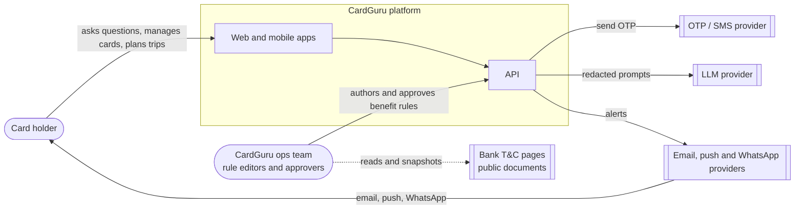
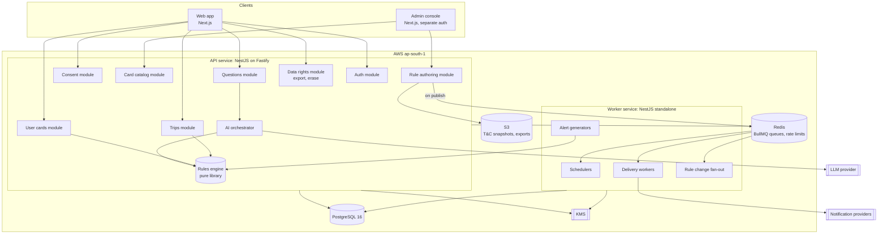
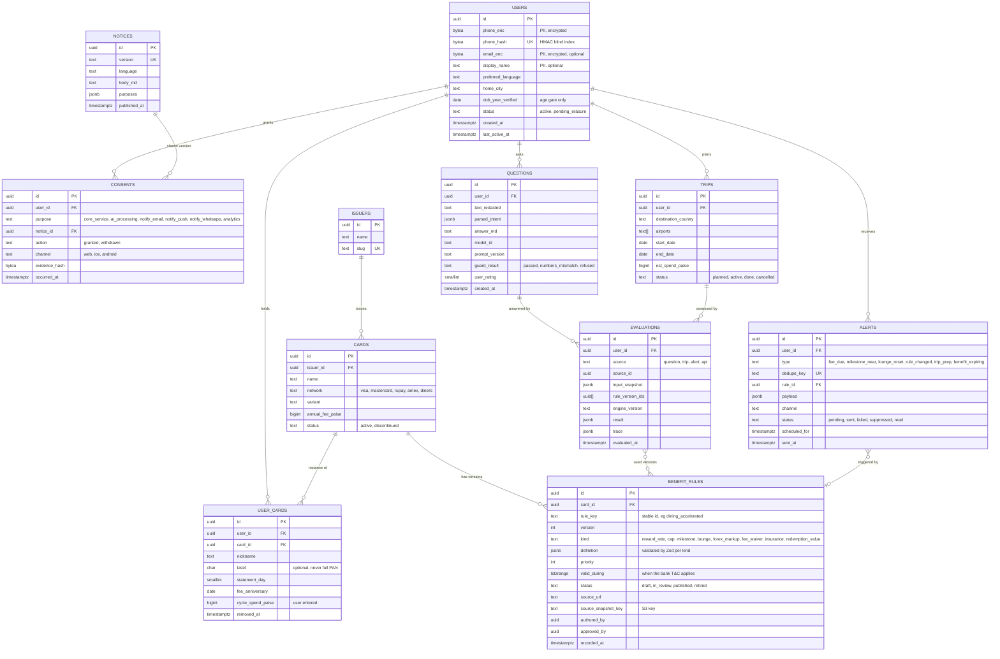
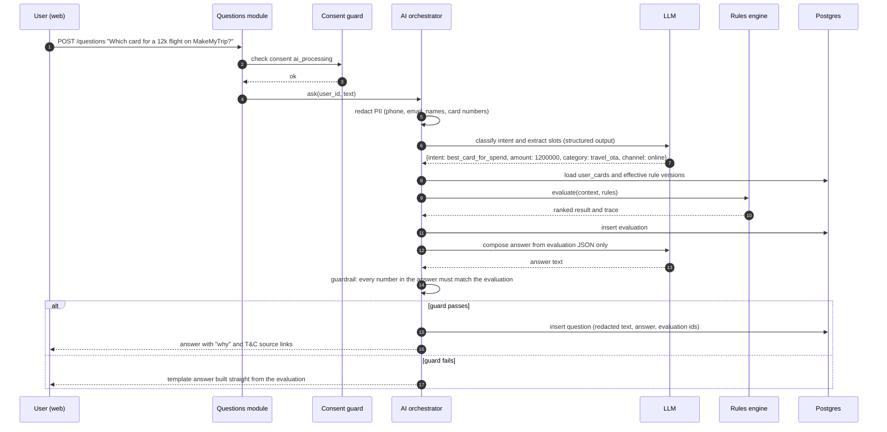
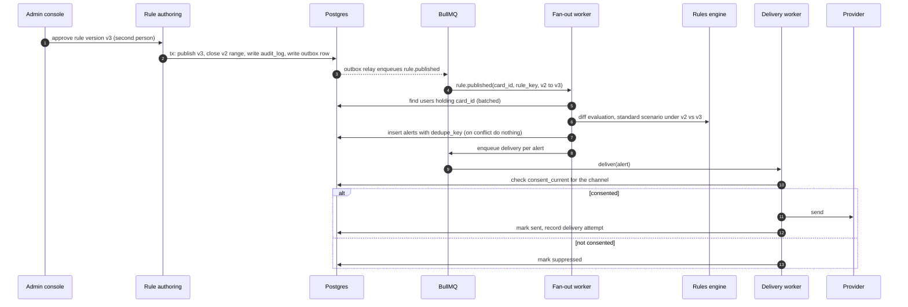
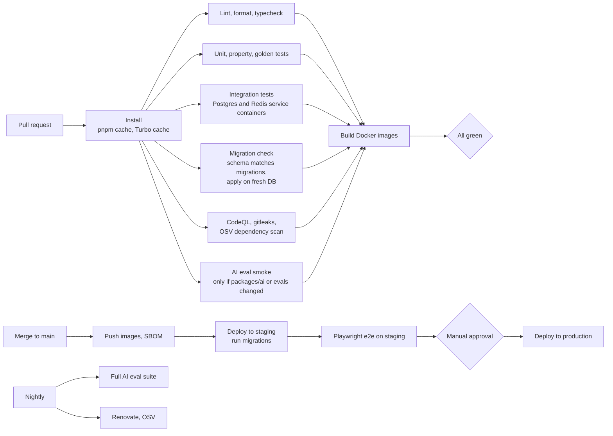

# CardGuru Architecture

| Field | Value |
|---|---|
| Status | Draft v0.1, for review |
| Date | 2026-10-14 |
| Scope | Architecture only. No application code exists yet. |
| Source inputs | No `CLAUDE.md` or `BUILD_PROMPTS.md` exist. This draft is built from the stated feature list and the assumptions in section 0. |

---

## 0. Assumptions to confirm

These assumptions drive the design. If any of them is wrong, the section named in the last column needs a revisit.

| # | Assumption | Affects |
|---|---|---|
| A1 | CardGuru is a consumer app for people in India who hold one or more credit cards. It tells them which card to use for a given spend, what benefits they have, and when to act (fees, milestones, lounge quotas, trips). | All |
| A2 | We **never** store full card numbers (PAN), CVV or expiry. A user's card is a link to a card product plus an optional nickname and the last 4 digits. | 4, 6 |
| A3 | v1 does **not** read transactions from banks, SMS or email. Spend for milestones is either entered by the user or not tracked. | 4, 5, 9 |
| A4 | Benefit rules are curated by an internal team from public bank T&C documents, not scraped and published automatically. | 4, 5 |
| A5 | Clients are a responsive web app first and a mobile app later. Login is by phone OTP. | 1, 6 |
| A6 | Stack is TypeScript end to end, in a single monorepo. | 2, 7 |
| A7 | Hosting is on AWS in Mumbai (`ap-south-1`), with all personal data stored in India. | 1, 6 |
| A8 | The LLM provider sits behind an interface. Default is Claude (Sonnet 5.5 for answers, Haiku 5.5 for classification). Only redacted text is sent to it. | 5, 6 |
| A9 | Small team (1 to 3 engineers) plus AI-assisted development. Conventions and guardrails matter more than raw throughput. | 2 |
| A10 | Users are 18+ (credit card holders), so the DPDP children's data rules are handled by an age gate, not parental consent. | 6 |

---

## 1. System context and components

### 1.1 System context



### 1.2 Containers and components



**Key decisions shown above**

- The **rules engine is a pure library** (`packages/rules-engine`) with no I/O. The API, the AI orchestrator and the worker all call the same code, so every surface gives the same number for the same input.
- **API and worker are two deployables built from one codebase**, so they share modules, DB schema and validation.
- The **admin console is a separate app with separate auth** (SSO plus MFA), so a consumer token can never reach rule authoring.

### 1.3 Repository layout (proposed)

```
apps/
  api/            NestJS (Fastify adapter) HTTP API
  worker/         NestJS standalone app: BullMQ processors and schedulers
  web/            Next.js consumer app
  admin/          Next.js internal console
packages/
  db/             Drizzle schema, migrations, seed data
  rules-engine/   Pure TS evaluation library (no I/O)
  rule-schemas/   Zod schemas for each benefit rule kind (shared by admin, API, engine)
  ai/             Prompt templates, tool definitions, redaction, output checks
  contracts/      Shared API types (generated from OpenAPI)
  config/         ESLint, tsconfig, Prettier presets
evals/            AI golden sets and runners
docs/             This file, ADRs, runbooks
```

Tooling: pnpm workspaces, Turborepo, Node 22 LTS, TypeScript strict mode.

---

## 2. Framework and ORM choices

### 2.1 API framework: NestJS vs Fastify

| Criterion | NestJS | Fastify (plain) |
|---|---|---|
| Structure for a growing codebase | Modules, DI, guards, interceptors are built in and opinionated | You design the structure yourself |
| Raw performance | Good. Close to Fastify when run on the Fastify adapter | Excellent |
| Consent and auth enforcement | Guards plus custom decorators (`@RequiresConsent('ai_processing')`) applied per route | Hooks. Works, but you build the pattern |
| Audit logging | Interceptors give one central place | `onRequest`/`onResponse` hooks |
| Background jobs | `@nestjs/bullmq` gives the same module system in the worker | Separate wiring |
| Testability | DI makes swapping the LLM, clock and DB easy | Manual DI or plugins |
| AI-assisted development | Strong conventions mean generated code tends to stay consistent across phases | More freedom, more drift |
| Downsides | Decorators, more boilerplate, steeper first week | Less guidance, conventions must be written down and enforced |

**Recommendation: NestJS running on the Fastify adapter.**

- We get Nest's structure (which matters most for a small team building in many phases) and Fastify's HTTP performance and schema validation underneath.
- Consent checks, audit logging and rate limiting are cross-cutting and map cleanly to guards and interceptors.
- The worker reuses the same modules as a Nest standalone app, so there's no second framework.
- Validation uses Zod (via `nestjs-zod`) rather than class-validator, so the same schemas work in the engine, admin console and API.

**What would change my mind:** if the API turns out to be a thin layer (fewer than about 10 routes) with most of the logic in the engine and worker, plain Fastify would be simpler.

### 2.2 ORM: Prisma vs Drizzle

| Criterion | Prisma | Drizzle |
|---|---|---|
| Schema style | Own DSL (`schema.prisma`) | TypeScript, close to SQL |
| Postgres features we need: JSONB, partial unique indexes, exclusion constraints on date ranges, row-level security, generated columns | Several need hand-written SQL migrations alongside the schema | Most can be expressed in the schema. The rest go in plain SQL migrations Drizzle manages |
| Migrations | Generated, good workflow, less transparent | Plain SQL files that are easy to review in PRs |
| Complex queries (effective rule as of a date, cohort fan-out) | Often falls back to raw SQL | Query builder handles them, with types |
| Runtime weight | Heavier client (lighter since v7) | Thin, no engine |
| Ecosystem and docs | Larger, more mature | Smaller but active |
| DPDP audit (being able to show exactly what SQL touches personal data) | Harder to see | Easy |

**Recommendation: Drizzle with PostgreSQL 16.**

- Versioned benefit rules depend on a Postgres **exclusion constraint** (no two published versions of the same rule can overlap in time) and on JSONB. Drizzle handles these without a second migration system.
- SQL-first migrations are easier to review for a schema that holds personal and financial data.
- JSONB columns can be typed with the same Zod schemas from `packages/rule-schemas`.

**What would change my mind:** if the team already knows Prisma well and the schema stays simple, Prisma's DX would win on speed.

---

## 3. Data model

### 3.1 Conventions

- Primary keys are `uuid` v7 (time-ordered, good for indexes).
- Money is stored as `bigint` **paise**. Rates are `numeric(10,6)`. Floats are never used for money or rates.
- Timestamps are `timestamptz`, stored in UTC and shown in IST.
- Personal data columns are marked `-- PII` in the schema and listed in `docs/data-inventory.md` (to be written), which also feeds the DPDP notice.
- Encrypted columns use envelope encryption with KMS. Lookups use an HMAC "blind index" column (for example `phone_hash`) so we never query plaintext.
- Soft delete is **not** used for personal data. Erasure is a real delete or an irreversible anonymisation (see 6.3).

### 3.2 Entity relationship diagram



Also needed but left off the diagram: `audit_log` (append-only, admin and data-rights actions), `admin_users`, `data_rights_requests`, `notification_deliveries` (one row per provider attempt).

### 3.3 Table notes

**users**
- Phone is the login identifier. It's stored encrypted and looked up through `phone_hash`.
- We keep only a verified "18 or over" flag (via `dob_year_verified`), not a full date of birth.

**consents** (append-only event log)
- Every grant or withdrawal is a new row, so we can always prove what a user agreed to, when, and against which notice version.
- The current state comes from a view, `consent_current` (latest event per user and purpose).
- `core_service` is required to use the app. Every other purpose is optional and can be withdrawn on its own.

**cards** (product catalog, not a user's card)
- One row per product, for example "HDFC Infinia".
- Public data only, so no PII.

**user_cards**
- Links a user to a product. This is how we follow RBI's rules on card data: no PAN, CVV or expiry, and `last4` is optional and only for display.
- `cycle_spend_paise` is entered by the user. It's what makes milestone and cap tracking possible without reading transactions (see Q3).

**benefit_rules** (versioned and bitemporal)
- `valid_during` is the **valid time**: when the bank's terms apply.
- `recorded_at` plus the row's immutability give the **transaction time**: when we learned about it.
- A published row is never updated. A change is a new `version` with a new range, and the old one is closed or retired.
- An exclusion constraint keeps published versions from overlapping:

```sql
ALTER TABLE benefit_rules ADD CONSTRAINT no_overlapping_published
  EXCLUDE USING gist (card_id WITH =, rule_key WITH =, valid_during WITH &&)
  WHERE (status = 'published');
```

- `definition` is checked against a Zod schema per `kind`. Here's an example of the `reward_rate` kind:

```json
{
  "scope": { "categories": ["dining"], "channels": ["online", "offline"] },
  "earn": { "points": 5, "per_amount_paise": 15000 },
  "stacking": "replaces_base",
  "exclusions": ["fuel", "rent", "wallet_load", "emi"],
  "cap_ref": "dining_monthly_cap"
}
```

- Publishing needs **two people**: the author can't approve their own rule. Each rule keeps an S3 snapshot of the T&C page it came from, so any answer can be traced back to its source.

**evaluations**
- One immutable record per engine run. It holds the full input snapshot, the exact rule version IDs used, the engine version and a step-by-step trace.
- That's enough to reproduce any answer, explain it to a user, and debug complaints.

**questions**
- Stores the **redacted** question text, the parsed intent, the final answer and the result of the guardrail check.
- Links to one or more evaluations.

**trips**
- Destination and dates feed evaluations for forex markup, lounge access at the listed airports, and travel insurance. They also schedule `trip_prep` alerts.

**alerts**
- `dedupe_key` (for example `fee_due:{user_card_id}:{2026}`) makes generation idempotent, so a scheduler running twice never sends twice.

---

## 4. How the rules engine, AI layer and alerts worker interact

### 4.1 The core principle

> The rules engine is the only source of numbers. The AI layer understands the question and explains the answer. It never calculates rewards, fees or eligibility itself.

This is the main defence against wrong financial answers from the AI.

### 4.2 Rules engine

- **Input:** an evaluation context and the set of rule versions in effect.
  - Context includes the user's cards, the spend (amount, category, channel, country, currency, date) and cycle state.
  - Rule versions are chosen as of the spend date, not today.
- **Process:**
  1. Filter rules by scope.
  2. Resolve conflicts by `priority`, then by specificity, then by `stacking` mode.
  3. Apply caps.
  4. Convert points to rupee value using the `redemption_value` rules.
  5. Rank the cards.
- **Output:** ranked results per card, with value in paise, applied rules, warnings (for example "cap reached" or "fuel excluded") and a trace.
- **Properties:** deterministic, no I/O, no clock (date is an input), and versioned (`engine_version` is recorded on every evaluation).

### 4.3 Question flow (AI layer)



**AI layer design rules**

- **Tools, not free text.** The LLM can only call read-only tools: `evaluate_spend`, `get_card_benefits`, `check_lounge_access` and `get_trip_summary`. The `user_id` comes from the session and is never taken from the model's arguments.
- **Redaction before every call.** Phone numbers, emails, 12 to 19 digit numbers that look like cards, and names (where possible) are masked. Only the redacted text is stored.
- **Number guard.** After the answer is written, any currency amount, percentage or point figure must appear in the evaluation result. If not, we fall back to a deterministic template answer.
- **Scope guard.** Questions about loans, credit scores, applying for cards or investment advice get a polite out-of-scope reply. An open question is whether "which new card should I get" is in scope (Q7).
- **Versioning.** `prompt_version` and `model_id` are stored on every question, so eval regressions can be traced.
- **Fallbacks.** If the LLM is down, structured endpoints like "best card for this spend" still work, because they call the engine directly.

### 4.4 Alerts worker

The worker runs BullMQ on Redis and has three kinds of producers.

| Producer | Trigger | Example alerts |
|---|---|---|
| Daily scheduler | Repeatable job at 07:00 IST, batched by user | `fee_due` 30 and 7 days before anniversary, `milestone_near` (user-entered spend at 80% or more), `lounge_reset` at quarter start, `benefit_expiring` |
| Trip scheduler | Trip start date minus 3 days | `trip_prep`: best card abroad, forex markup, lounges at the listed airports |
| Rule change fan-out | `benefit_rules` publish event | `rule_changed`: "Your Axis Atlas lounge access changes from 1 Nov" with a before and after diff from the engine |



**Reliability rules**

- **Transactional outbox.** Publish events are written in the same DB transaction as the rule change, so we never publish without alerting or alert without publishing.
- **Idempotency** comes from the `dedupe_key` unique constraint, plus a provider idempotency key where the provider supports one.
- **Retries:** exponential backoff, 5 attempts, then a dead-letter queue with an on-call alert.
- **Quiet hours:** nothing goes out between 21:00 and 08:00 IST except time-critical alerts.
- **Consent is checked at send time**, not just at creation, so a withdrawal takes effect straight away.

---

## 5. Security and DPDP compliance

### 5.1 Regulatory frame

| Source | What it means for us |
|---|---|
| Digital Personal Data Protection Act, 2023 | We are a Data Fiduciary. We need a lawful basis (consent), clear notice, purpose limitation, data minimisation, security safeguards, breach notification and data principal rights. |
| DPDP Rules, 2025 (notified November 2025, phased start) | These add detail on notice content, consent manager interop, breach reporting timelines, keeping logs for at least 1 year, and erasure notices. Most obligations start about 18 months after notification. **Counsel must confirm the dates and what applies to us.** |
| RBI card data rules (tokenisation, card-on-file) | Non-issuer entities must not store card credentials. We store no PAN, CVV or expiry, and at most the last 4 digits. |
| IT Act and CERT-In directions | Report cyber incidents to CERT-In within 6 hours. Keep logs for 180 days, in India. |

> This section is an engineering approach, not legal advice. A privacy lawyer should review it before launch (R5).

### 5.2 DPDP controls built into the design

| DPDP requirement | How CardGuru meets it |
|---|---|
| Notice before consent | `notices` table, versioned per language. Shown in the onboarding flow. Each consent row records the notice version. |
| Free, specific, informed, clear consent | Purposes are listed one by one with separate toggles. No pre-ticked boxes. `core_service` is the only required purpose. |
| Withdrawing is as easy as giving | One-tap withdrawal per purpose in settings. Takes effect at once, since guards and the delivery worker read `consent_current`. |
| Purpose limitation | `@RequiresConsent(purpose)` guard on every route that processes data for an optional purpose. CI fails if a route lacks a purpose annotation. |
| Data minimisation | No PAN, no transactions, no full date of birth, and redacted question text. The LLM gets only redacted text plus evaluation JSON. |
| Accuracy and correction | Users can edit their profile, cards and trips. |
| Right to access | "Download my data" builds a JSON plus PDF export through the worker, stored in S3 with a 24-hour signed URL. |
| Right to erasure | Erasure request leads to `pending_erasure`, then a hard delete or irreversible anonymisation (evaluations are kept only as aggregates with no user link), within a stated SLA. The audit log keeps a pseudonymous record of the request. |
| Retention | A retention table per data class, enforced by a nightly purge job. Example: inactive accounts get a 48-hour notice then deletion after N years (N to be confirmed, Q9). |
| Grievance redressal | In-app grievance form and published contact. `data_rights_requests` tracks SLA. |
| Nominee | Users can name a nominee in settings, stored encrypted. |
| Security safeguards | See 5.3. |
| Breach notification | Runbook: notify the Data Protection Board and affected users without delay, with the detailed report within 72 hours, and CERT-In within 6 hours. Templates are kept in `docs/runbooks/`. |
| Processors | Data processing agreements with the LLM, OTP, email, WhatsApp and cloud providers. LLM provider set to zero data retention where available. |
| Cross-border transfer | Personal data stays in India. Only redacted text goes to the LLM, which may be hosted outside India. This is allowed unless a country is restricted, but counsel should confirm (Q8). |

### 5.3 Security controls

| Area | Control |
|---|---|
| Identity | Phone OTP with rate limits per phone, IP and device. OTP valid for 5 minutes, max 5 tries. Short-lived access JWT (15 minutes) plus rotating refresh token in an httpOnly cookie, with reuse detection. |
| Admin | Separate IdP with SSO and mandatory MFA. RBAC roles: `rule_editor`, `rule_approver`, `support`, `dpo`. Four-eyes rule publishing. All actions go to `audit_log`. |
| Data at rest | RDS and S3 encryption with KMS. Envelope encryption for PII columns. Separate KMS keys per environment. |
| Data in transit | TLS 1.2 or higher everywhere, HSTS, no plaintext internal hops. |
| Secrets | AWS Secrets Manager. Nothing in env files committed to git. gitleaks runs in CI. |
| Application | OWASP ASVS Level 2 as the target. Zod validation on every input. Strict CSP on web. Rate limiting via Redis. |
| AI-specific | Prompt injection defences: T&C content and user text are treated as data, tools are read-only and scoped to the user from the session, outputs are number-guarded, and there's no tool that writes. |
| Logging | Pino with redaction paths for PII. Request IDs. OpenTelemetry traces. No PII in traces. |
| Supply chain | Renovate, pnpm lockfile, `pnpm audit` and OSV scan, CodeQL, SBOM on each image, pinned base images. |
| Infra | Private subnets for DB and Redis, least-privilege IAM per service, WAF in front of the load balancer. |
| Assurance | Threat model (STRIDE) before Phase 5. External penetration test before public launch. |

---

## 6. Testing strategy and CI pipeline

### 6.1 Test pyramid

| Layer | Tool | What it covers | Target |
|---|---|---|---|
| Unit | Vitest | Pure logic, especially `rules-engine` and `rule-schemas` | Engine at 95% or more line and branch coverage |
| Property-based | fast-check | Engine invariants: rewards never go above a cap, a spend that's excluded earns 0, ranking never depends on input order, money stays an integer number of paise | Runs with unit tests |
| Golden card fixtures | Vitest plus JSON fixtures | Per card: hand-checked scenarios taken from the bank T&C, with expected values | Every published card has at least 10 scenarios |
| Integration | Vitest plus Testcontainers (Postgres, Redis) | Repositories, migrations, the exclusion constraint, consent guard, outbox to alert flow | All modules |
| API contract | OpenAPI generated from Nest, checked with Schemathesis | Response shapes and error codes | All public routes |
| End to end | Playwright | Onboarding with consent, add card, ask question, withdraw consent, data export | Critical journeys |
| AI evals | Custom runner in `evals/` | Intent extraction accuracy, number-guard pass rate, refusal correctness, answer quality via an LLM judge with a rubric | Gates on prompt or model change |
| Load | k6 | Questions and best-card endpoints, worker fan-out for 100k users | Before launch |

**AI eval gates (initial targets, to be tuned):**

- Intent and slot accuracy of at least 95% on the golden set
- Number-guard failure rate below 1%
- 100% correct refusals on the out-of-scope set
- No regression of more than 2 points on judge score versus the main branch

### 6.2 CI pipeline (GitHub Actions)



**Pipeline rules**

- Turbo affected-only runs keep PR checks fast. The target is under 8 minutes.
- Branch protection on `main`: required checks, 1 review, no direct pushes.
- Migrations run as a separate pre-deploy step and must be backward compatible (expand, then contract) so a rollback never breaks the schema.
- Engine coverage below threshold fails the build. Overall coverage is reported but not gated.

---

## 7. Phased delivery plan

`BUILD_PROMPTS.md` doesn't exist yet. The phases below are my proposal. Once you approve them, I'll turn each one into a prompt in a new `BUILD_PROMPTS.md`.

| Phase | Name | Scope | Exit criteria |
|---|---|---|---|
| 0 | Foundations | This doc and its answers. `CLAUDE.md` with conventions. Monorepo scaffold, CI skeleton, ADRs for the decisions above. | CI green on an empty scaffold. Open questions answered. |
| 1 | Identity and consent | Auth (phone OTP, sessions), `users`, `notices`, `consents`, consent guard, `audit_log`, PII encryption helpers | Onboarding with notice and consent works end to end. Withdrawal blocks guarded routes. Integration tests pass. |
| 2 | Card catalog and rule authoring | `issuers`, `cards`, `benefit_rules` with versioning and exclusion constraint, Zod rule schemas, admin console with four-eyes publish, T&C snapshots, outbox | 10 to 20 popular cards seeded and published with sources. Overlap constraint proven by tests. |
| 3 | Rules engine and wallet | `rules-engine` package, `user_cards`, "best card for this spend" API, `evaluations` with trace, basic web UI | Golden fixtures pass for every seeded card. Property tests pass. A user can add cards and get a ranked answer with a "why". |
| 4 | AI question layer | AI orchestrator, redaction, tools, number guard, `questions`, eval harness and golden sets | Eval gates in 6.1 met. LLM outage falls back cleanly. |
| 5 | Alerts worker | Worker app, schedulers, fan-out, delivery with consent check, quiet hours, DLQ, in-app alert inbox | Rule publish creates the correct alerts exactly once. Withdrawn channel consent suppresses delivery. |
| 6 | Trips | `trips`, trip evaluations (forex, lounges, insurance), `trip_prep` alerts | A trip shows the best card abroad and eligible lounges. Pre-trip alert fires on schedule. |
| 7 | Data rights and hardening | Export, erasure, retention purge, grievance flow, threat model, pen test, load test, observability dashboards, runbooks | DPDP checklist signed off by counsel. Pen test high findings fixed. Load targets met. |
| 8 | Beta launch | Staged rollout, feedback loop, rule update operations | Agreed beta metrics (to define, Q10). |

---

## 8. Open questions

| # | Question | Why it matters |
|---|---|---|
| Q1 | Do you want me to write `CLAUDE.md` (coding conventions) and `BUILD_PROMPTS.md` (from section 7) once this doc is approved? | These were meant to be the source documents. |
| Q2 | Who are the first users, and what's the launch target: personal project, closed beta, or public launch? Any rough date? | Sets how much of Phase 7 is needed before anyone uses it. |
| Q3 | How do we know a user's spend for milestones and caps? Options: (a) user enters it, (b) statement PDF upload, (c) Account Aggregator, (d) not tracked in v1. | Biggest product and compliance choice. (b) and (c) bring in much more sensitive data. |
| Q4 | Which cards and how many at launch? Who maintains rules when banks change T&C, and how quickly? | Rule freshness is the product. |
| Q5 | Web only first, or mobile at launch? Which notification channels: email, push, WhatsApp, SMS? | Affects Phases 1 and 5, plus provider contracts. |
| Q6 | LLM provider: is Claude fine as the default? Any budget limit per user per month? | Cost model and DPA. |
| Q7 | Is "which new card should I apply for" in scope? Any affiliate or referral revenue planned? | If yes, it creates conflict-of-interest and disclosure duties. It also changes the scope guard. |
| Q8 | Is it acceptable for redacted question text to be processed by an LLM hosted outside India? | DPDP cross-border transfer and user trust. |
| Q9 | Retention periods: inactive accounts, questions, evaluations? | Needed for the purge job and the notice. |
| Q10 | What does success look like for beta (users, questions per week, answer accuracy)? | Defines Phase 8 exit and what we instrument. |
| Q11 | Any preference to change: AWS vs GCP, NestJS vs plain Fastify, Drizzle vs Prisma? | Cheap to change now, expensive after Phase 1. |
| Q12 | Do you have a privacy lawyer or DPO lined up? | Required sign-off before public launch. |

---

## 9. Risks

| # | Risk | Likelihood | Impact | Mitigation |
|---|---|---|---|---|
| R1 | **Stale or wrong benefit rules.** Banks change T&C often and quietly, so users act on old data. | High | High | Show "last verified" date on every answer. Weekly T&C snapshot diff job flags changes for review. Source link on every answer. Users can report "this is wrong". |
| R2 | **AI states a wrong number** about money. | Medium | High | Engine is the only source of numbers, plus the number guard, template fallback and eval gates. |
| R3 | **Milestone and cap features are weak without spend data** (if Q3 is "user enters it"). | High | Medium | Make manual entry quick. Treat estimates as estimates in the UI. Revisit with AA or statement upload after beta. |
| R4 | **Rule model can't express a real bank rule** (tiered, merchant-specific, time-boxed offers). | Medium | Medium | Model 10 diverse real cards in Phase 2 before freezing schemas. Keep an `escape_hatch` kind with a manual note. Schemas are versioned. |
| R5 | **DPDP interpretation gaps** (Rules phase-in, cross-border, retention). | Medium | High | Counsel review before launch (Q12). Design is already consent-first and minimal. |
| R6 | **Liability and trust:** users treat answers as financial advice. | Medium | Medium | Clear disclaimers. Strict scope guard. No card application advice without disclosure (Q7). |
| R7 | **Card data compliance creep:** a feature later tries to store full PAN or SMS transactions. | Low | High | Written rule in `CLAUDE.md`. Schema has no column for it. CI grep check for PAN-like patterns in fixtures and logs. |
| R8 | **LLM cost growth** as usage grows. | Medium | Medium | Small model for classification. Engine-only answers for structured intents. Per-user rate limits. Prompt caching. |
| R9 | **Alert fatigue** leads to users turning everything off. | Medium | Medium | Frequency caps, quiet hours, per-type toggles, track open and disable rates. |
| R10 | **Small team, broad scope.** Phases slip. | High | Medium | Strict phase exit criteria. Trips and WhatsApp can move after beta. |
| R11 | **Assumptions in section 0 are wrong**, because this doc was written without `CLAUDE.md` or `BUILD_PROMPTS.md`. | Medium | High | Answer section 8 before Phase 1. Update this doc and record ADRs. |
